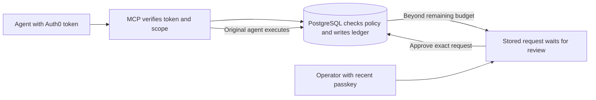

# AgentGuard MCP

[](https://m8ven.ai/mcp/haisamar-agentguard-mcp-mpew3p)

AgentGuard gives an AI support agent limited authority to request refunds. The
Python MCP server verifies Auth0 identity and scopes. PostgreSQL checks a shared
rolling budget, holds sensitive requests for an independent human decision, and
records authorized effects in a simulated USD ledger.

[Try the public demo](https://agentguard-eight.vercel.app/demo) · [Inspect the evidence](https://agentguard-eight.vercel.app/evidence) · [Frontend repository](https://github.com/haisamar/agentguard) · [Creator case study](https://agentguard-eight.vercel.app/about)

## What the safeguard does

- A machine needs `finance:refund` to request or execute a refund. A machine
  with `agent:manage` can inspect pending requests and cannot approve them.
- Eligible refunds consume a shared $500 rolling 24-hour autonomous budget.
  A request beyond the remaining budget waits for review, even when the
  individual amount is below $500.
- The protected dashboard requires the configured verified operator. Approval
  and resume also require recent passkey or MFA authentication. The reviewer
  sees the stored amount, destination, reason, and expiry. The original agent
  can execute an unexpired approved request once. Operators can cancel pending
  or approved requests and pause new execution.
- A stable request ID gives identical retries the same submission result.
  Changed arguments with the same ID are rejected. Review commits with its audit
  event. Execution commits with its receipt and audit event.



## Reproduce the evidence

From a clone of this repository, use Node.js 24 or newer:

```sh
cd evaluation
npm ci --ignore-scripts
npm run --silent evaluate
```

The runner applies the schema and migrations to an empty local PostgreSQL
instance and runs seven SQL assertion files. On ten fixed cases, AgentGuard
matched the expected ledger effects in 10 of 10, compared with 3 of 10 for the
scope-and-threshold baseline and 1 of 10 for the unguarded baseline. The
[evaluation guide](evaluation/README.md) explains the single-connection setup
and illustrative baselines. It requires no hosted credentials.

The [evidence index](SUBMISSION-EVIDENCE.md) links the hosted passkey and receipt
run, a separate concurrency trial, and the exact release references.

## MCP tools

| Tool | Scope | Behavior |
| --- | --- | --- |
| `search_accounts(query)` | `crm:read` | Searches synthetic CRM accounts. |
| `issue_refund(request_id, account_id, amount_minor, currency, reason)` | `finance:refund` | Submits a v2 request and may return a receipt or a pending approval. |
| `execute_approved_refund(approval_id)` | `finance:refund` | Executes the stored transaction once if the original requester and approval still qualify. |
| `list_pending_approvals()` | `agent:manage` | Lists pending approvals for authorized machine operators. |
| `approve_action(approval_id)` | `agent:manage` | Rejects machine approval and directs the caller to the dashboard. |

Use integer cents and a stable request ID when calling `issue_refund`. The
[v2 contract](REFUND-CONTRACT.md) documents validation and retry behavior.
The hosted [MCP endpoint](https://agentguard-mcp-wine.vercel.app/mcp) requires
an Auth0 bearer token with the configured API audience and tool scope.

## Run the backend locally

Use Python 3.12. Install from the hash-pinned export in a virtual environment:

```sh
python -m pip install --require-hashes -r requirements.txt
```

Copy `.env.example` to `.env` and configure your isolated Auth0 API and Supabase
project. Set `AUTH0_AUDIENCE` to the API identifier and `MCP_SERVER_URL` to the
server base URL. Apply `database/schema.sql` then migrations `001` through `008`
in order. See the [hosted rehearsal guide](HOSTED-REHEARSAL.md) for Auth0 client
scopes, service role grants, and frontend configuration.

```sh
python -m src.server
```

By default, the server listens on port 3001. Connect your client to
`http://localhost:3001/mcp`. `/health` confirms the process responds. For a 401,
check the bearer token, issuer, audience, and time claims. For tool denials, check
scope and the returned policy reason. For a database failure, check project
availability, credentials, and migration state before attempting another write.
Reuse the original request ID for an identical submission retry.

Run `python -m unittest discover -s tests -v` with the test configuration in
[CI](.github/workflows/checks.yml). See [hosting](DEPLOYMENT.md) and [dependency
verification](DEPENDENCIES.md) for deployment and lockfile details.

## Trust boundary

The ledger records simulated money. AgentGuard trusts Auth0, the backend service
credentials, and privileged database operators. The audit trail is persisted in
PostgreSQL. It is not a tamper-proof log against a privileged database operator.
The public walkthrough uses fixtures, and the reports distinguish hosted
observations from local comparisons and isolated authorization tests.
